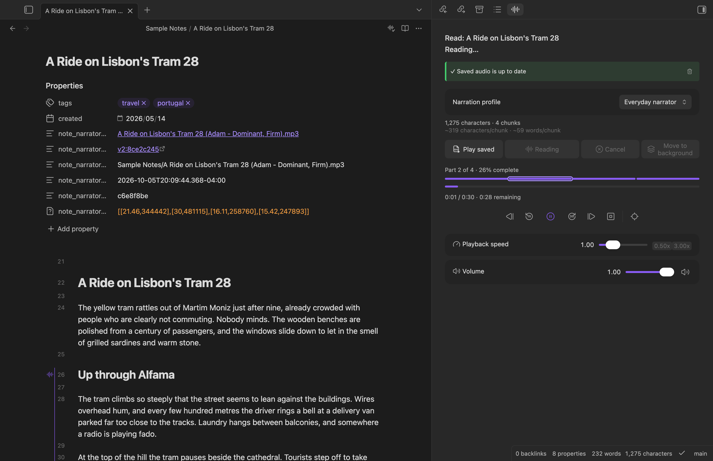
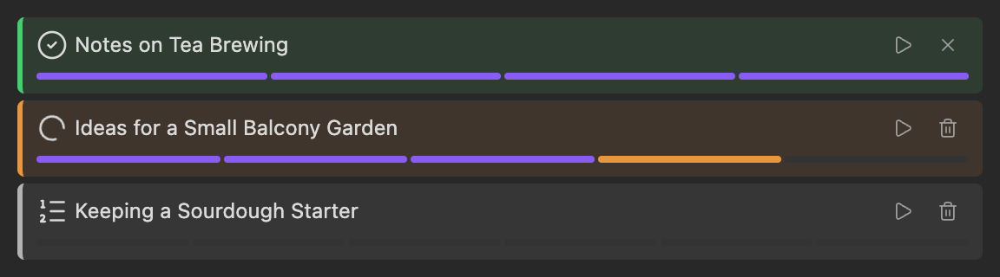
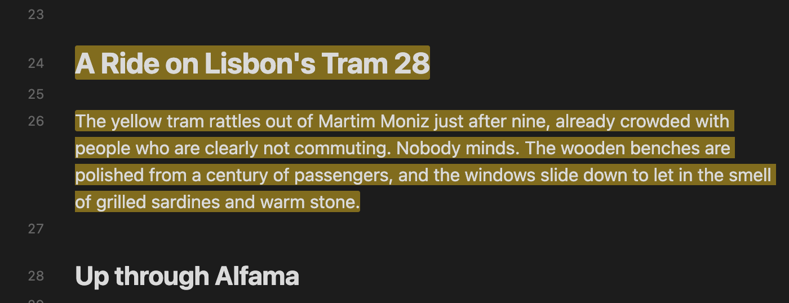
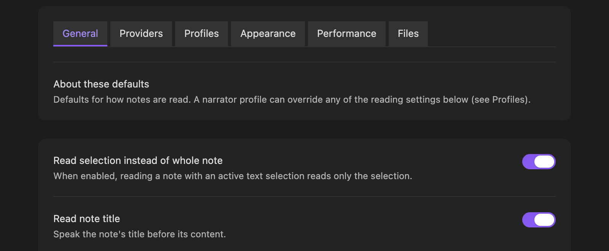
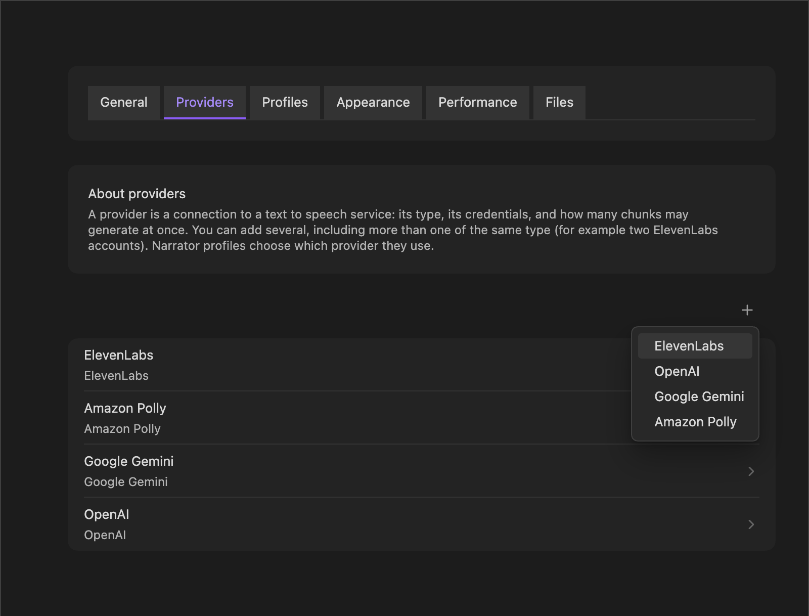

# Note Narrator

Note Narrator is an Obsidian plugin that **reads your notes aloud** using text to speech, with ElevenLabs, OpenAI, Google Gemini or Amazon Polly. Open the panel, press **Read**, and it starts playing while the rest of the note is still being generated. It can save the audio next to your note, so you can listen again for free.

**Requires an account and API key with one of those providers, and the provider charges for the audio it generates** (some have limited free tiers). The text you read is sent to that provider. See [Requirements and costs](#requirements-and-costs) and [Disclosures](#disclosures) before installing.

**Full documentation and usage guide: [the Note Narrator docs](https://obsidian-plugins.pablokvitca.com/note-narrator).**

## Key features

- **Read aloud** the whole note, or just your selection, from the panel or the **Read note aloud** command. Playback starts as soon as the first part is ready.
- **Playback controls:** pause, rewind and skip, previous and next part, speed and volume.
- **Highlighting:** the part being read is marked in the editor, as a margin marker, background wash or underline, and you can scroll to it.
- **Background generation:** generate notes without playing them, one at a time, and play them from the panel when they're ready. A note edited since is marked **Outdated**.
- **Saved audio:** save the audio in your vault (`.mp3`, or `.wav` with Google Gemini), link it from the note, and see when it's out of date. Replaying it costs nothing.
- **Four providers:** ElevenLabs, OpenAI, Google Gemini and Amazon Polly. Add several, even of the same type, each with its own key.
- **Narrator profiles:** a provider, a voice and its settings, and optional reading options, switchable from the panel.
- **Reading options:** read the title and properties, skip sections by heading, skip comments, and choose how notes are split into parts.
- Works on desktop and mobile.

## Platforms

Note Narrator uses only Obsidian's cross-platform APIs, so every feature is the same on every device. The difference is how much each platform has been tested.

| Feature | macOS | Windows | Linux | iPhone | iPad | Vision Pro | Android |
| --- | --- | --- | --- | --- | --- | --- | --- |
| Read aloud and playback controls | ✅ | ❔ | ❔ | ✅ | ✅ | ✅ | ❔ |
| Highlighting and scroll to current | ✅ | ❔ | ❔ | ✅ | ✅ | ✅ | ❔ |
| Background generation | ✅ | ❔ | ❔ | ✅ | ✅ | ✅ | ❔ |
| Saved audio | ✅ | ❔ | ❔ | ✅ | ✅ | ✅ | ❔ |
| Narrator profiles and settings | ✅ | ❔ | ❔ | ✅ | ✅ | ✅ | ❔ |

✅ Tested on a real device. ❔ Should work, but nobody has tried it yet; reports welcome. iPad includes iPad mini. Requires **Obsidian 1.13.1 or newer** everywhere. Details: [Supported platforms](https://obsidian-plugins.pablokvitca.com/note-narrator/reference/supported-platforms).

## Text to speech providers

| | ElevenLabs | OpenAI | Google Gemini | Amazon Polly | Apple OS (Local) |
| --- | --- | --- | --- | --- | --- |
| Status | ✅ Available | ✅ Available | ✅ Available (preview models) | ✅ Available | 🔜 Planned |
| Platforms | All | All | All | All | Apple devices only |
| Needs an account and API key | Yes | Yes | Yes | Yes (AWS access keys) | No |
| Needs an internet connection | Yes | Yes | Yes | Yes | No |
| Costs | Credits on your ElevenLabs plan | OpenAI's API pricing | Google's API pricing | AWS's Polly pricing | Free |
| Saved audio | `.mp3` | `.mp3` | `.wav` | `.mp3` | 🔜 |
| Voices | Your account's voices | 13 built-in voices | 30 prebuilt voices | Polly's voices, by engine | 🔜 |
| Models | Eleven v3, Eleven Multilingual v2, Eleven Flash v2.5 | GPT-4o mini TTS, TTS-1, TTS-1 HD | Gemini 2.5 Flash TTS, Gemini 2.5 Pro TTS | Standard, Neural, Long-form and Generative engines | 🔜 |
| Voice settings | Stability, similarity | Speaking speed, instructions | Instructions | Engine (the region is set on the provider) | 🔜 |
| Parallel generation | Yes, with automatic retry when rate-limited | Yes, with automatic retry when rate-limited | Yes, with automatic retry when rate-limited | Yes, with automatic retry when throttled | 🔜 |

Planned providers are on the [Roadmap](https://obsidian-plugins.pablokvitca.com/note-narrator/roadmap). Plans can change.

## Install

Requires **Obsidian 1.13.1 or newer**.

- **Community plugins (recommended):** open **Settings → Community plugins → Browse**, search for **Note Narrator**, and install it.
- **BRAT:** install [BRAT](https://github.com/TfTHacker/obsidian42-brat), run **BRAT: Add a beta plugin for testing**, and enter `pablokvitca/note-narrator`, to get updates ahead of the community directory or a beta build.
- **Manually:** download `main.js`, `manifest.json` and `styles.css` from the [latest release](https://github.com/pablokvitca/note-narrator/releases/latest) into `<your vault>/.obsidian/plugins/note-narrator/`, then enable it under **Settings → Community plugins**.

Then follow the [Quick start](https://obsidian-plugins.pablokvitca.com/note-narrator/getting-started/quick-start): add a provider and its key under **Settings → Note Narrator → Providers**, open a note, open the panel from the ribbon, and press **Read**. Each provider has a guide to creating a key with only the permissions it needs, a spending limit and an expiration date: [ElevenLabs](https://obsidian-plugins.pablokvitca.com/note-narrator/getting-started/setting-up-elevenlabs), [OpenAI](https://obsidian-plugins.pablokvitca.com/note-narrator/getting-started/setting-up-openai), [Google Gemini](https://obsidian-plugins.pablokvitca.com/note-narrator/getting-started/setting-up-google-gemini) and [Amazon Polly](https://obsidian-plugins.pablokvitca.com/note-narrator/getting-started/setting-up-amazon-polly).

## Requirements and costs

- You need an **account and API key with at least one provider**: ElevenLabs, OpenAI, Google Gemini or Amazon Polly (AWS access keys). Note Narrator is free, but **the provider charges for the audio it generates** (credits on your ElevenLabs plan, or the API prices of OpenAI, Google or AWS; ElevenLabs and Google Gemini have limited free tiers). You are responsible for those costs. Set a spending limit with your provider: the setup guides above show how.
- Reading needs an **internet connection**. There is no offline mode yet.
- Saved audio replays for free. Regenerating it, or reading again, costs again.
- **Your provider's terms apply to you and the audio.** For example, ElevenLabs requires you to be 18 or over (or of legal age where you live), and its free accounts may only be used for non-commercial purposes. Check your provider's terms and plan before using saved audio commercially.

## Disclosures

Obsidian asks plugins to be clear about what they do with your data. For Note Narrator:

- **Network use.** The plugin only talks to the providers you set up, and only when you read, regenerate, or generate in the background (or open a note with "Auto-generate on open" turned on, which also needs saving and linking), and, for ElevenLabs, when it lists your voices or names a saved file (below). Each read sends the **text being read**, the narrator profile's voice and model settings, and your key, to that profile's provider:
  - **ElevenLabs (`api.elevenlabs.io`)**, under its [Terms of Service](https://elevenlabs.io/terms-of-use) and [Privacy Policy](https://elevenlabs.io/privacy-policy). ElevenLabs is also asked for your account's voices whenever you open a narrator profile's settings (with an API key set) or press the voice refresh button, and for the voice's name each time audio is saved, to name the file.
  - **OpenAI (`api.openai.com`)**, under its [Services Agreement](https://openai.com/policies/services-agreement) and [Privacy Policy](https://openai.com/policies/privacy-policy).
  - **Google (`generativelanguage.googleapis.com`)**, under the [Gemini API Additional Terms](https://ai.google.dev/gemini-api/terms) and [Google Privacy Policy](https://policies.google.com/privacy). On the free tier, Google may use what you send to improve its products.
  - **AWS (`polly.<region>.amazonaws.com`, in the region you choose)**, under the [AWS Customer Agreement](https://aws.amazon.com/agreement/) and [Privacy Notice](https://aws.amazon.com/privacy/). Requests are signed with your secret access key, which is never sent; only the access key ID is.
  - Requests a provider rate-limits are retried automatically and resend the same text, which can cost more. OpenAI's, Google's and AWS's voices are fixed lists, so nothing is sent to list or name them. Replaying saved audio needs no network access and costs nothing.
- **What is read.** The text sent is the note or selection after Markdown is stripped, plus the note title and properties if you enabled those. **Anything you read leaves your device and is processed by your provider** under its own terms and privacy policy. The plugin author has no control over how providers store or use that data. Do not read notes containing text you are not willing to send to them.
- **Your API key** (or AWS access keys) is stored in Obsidian's built-in secret storage, not in the plugin's `data.json`. Only the name of the secret is saved.
- **Files it writes.** Settings in the plugin's `data.json`. If you turn on saving: `.mp3` files (`.wav` with Google Gemini) in your vault (next to the note, or in a folder you choose) and, with linking on, a few properties in the note's frontmatter. **Clear Note Narrator files** moves the linked audio file to the trash (following your vault's deletion setting) and removes those properties. The plugin does not read or write files outside your vault.
- **Other notes it looks at.** Only one thing, on by default: before replacing or trashing a note's saved audio, it checks the other notes' Note Narrator audio path property, from Obsidian's metadata cache and never the notes' text, so a copied note doesn't overwrite or trash audio it shares with the original. That check lists every note in your vault, which is why Obsidian's plugin scanner reports "vault enumeration". Nothing it sees leaves your device. Turning off **Protect audio shared with copied notes** (Files tab) skips it, but then regenerating or clearing a copied note can overwrite or trash the original's audio.
- **No telemetry, no ads, no self-updates.** The plugin collects no usage data, shows no advertising, and does not install or update itself or any code.
- **Synthetic voices.** The audio is AI-generated. If you share it, consider saying so, and follow your provider's rules on voice rights and permitted content (for example ElevenLabs' [Prohibited Use Policy](https://elevenlabs.io/use-policy), OpenAI's [Usage Policies](https://openai.com/policies/usage-policies), Google's [Generative AI Prohibited Use Policy](https://policies.google.com/terms/generative-ai/use-policy) and AWS's [Acceptable Use Policy](https://aws.amazon.com/aup/)).

More detail: [Privacy and network use](https://obsidian-plugins.pablokvitca.com/note-narrator/reference/privacy). Known limitations, such as HTML comments being read aloud, are listed in the [docs](https://obsidian-plugins.pablokvitca.com/note-narrator/reference/known-limitations).

## Disclaimer

Note Narrator is provided **"as is", without warranty of any kind**. The author is not liable for any costs, data loss, or other damages arising from its use, including charges from any provider. It is an independent project, **not affiliated with, endorsed by, or sponsored by ElevenLabs, OpenAI, Google, Amazon Web Services or Obsidian**. All trademarks belong to their owners.

## License

The source code is open: [github.com/pablokvitca/note-narrator](https://github.com/pablokvitca/note-narrator). The `main.js` in each release is built from this repository by GitHub Actions. Released under the [0BSD license](LICENSE). Third-party attributions and notices are in [THIRD_PARTY_NOTICES.md](THIRD_PARTY_NOTICES.md).

## Development

See [DEVELOPMENT.md](DEVELOPMENT.md) and [CONTRIBUTING.md](CONTRIBUTING.md) for details on dev setup and contributions.
